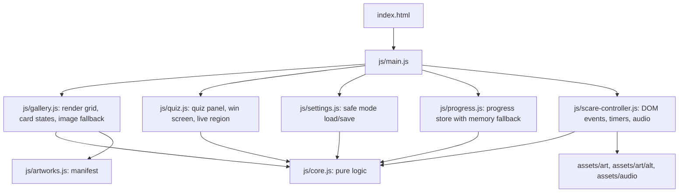
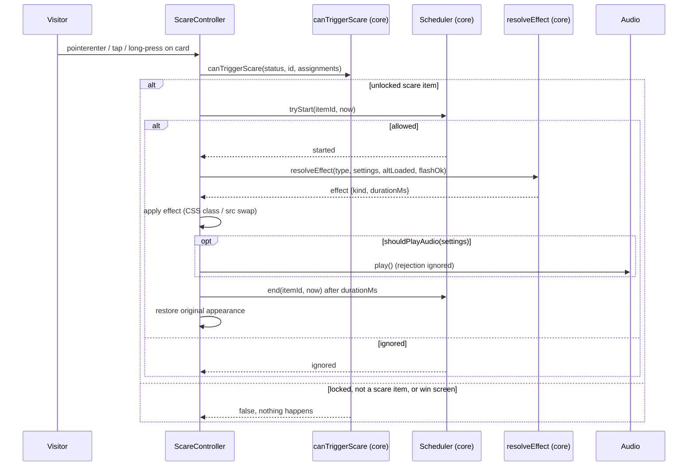
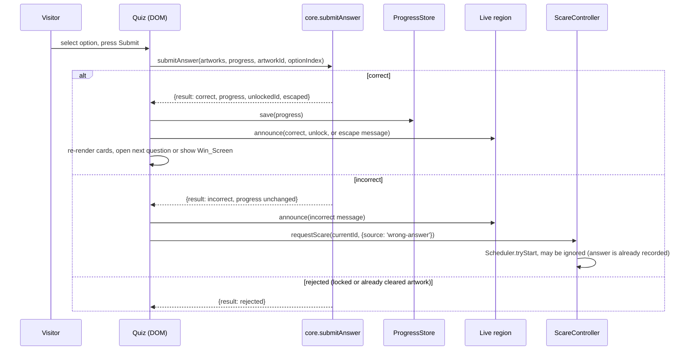

# Design Document: Spooky Gallery

## Overview

Spooky Gallery is a static spooky escape quiz game built with plain HTML, CSS, and JavaScript. There is no build step, no backend, and no network access beyond bundled files. It renders 8 to 12 bundled SVG artworks in a responsive grid. Each artwork carries one multiple-choice question in the manifest. Artworks unlock along a fixed linear path: the next artwork opens only after the previous question is answered correctly, and answering the last question correctly shows the win screen. A wrong answer triggers a jump scare, with unlimited retries and no lives or game over. A hidden subset of the artworks (the Scare_Items) also fires an unsignposted jump scare on hover (or tap or long-press) while unlocked. A jump scare is a visual effect plus an optional audio sting.

Key design decisions:

- **Works from `file://`.** Browsers block ES modules and `fetch` on `file://` origins. The site therefore uses classic `<script defer>` tags, a global namespace (`window.Spooky`), and artwork data in a JS file instead of JSON loaded at runtime.
- **Pure core, thin DOM shell.** All decisions (effect resolution, scare pacing, flash limiting, settings, gesture classification, audio permission, manifest validation, answer checking, unlock state, win detection, progress serialization, announcements) live in pure, clock-injected functions in `js/core.js`. DOM, audio, storage handles, and timers are wired in separate files. This makes the logic testable with property-based tests in Node, with no impact on the shipped site.
- **One scare pipeline.** Hover, touch, and wrong-answer scares all go through the same path: `Scheduler.tryStart`, then `resolveEffect`, then `shouldPlayAudio`, then the flash limiter. No code path can bypass safe mode, reduced motion, cooldown, or the flash cap.
- **Game state is derived, not duplicated.** The only stored game fact is the list of cleared artwork ids. Locked, unlocked, cleared, current, and escaped are computed from that list and the manifest order.
- **Audio.** Stings are short bundled `.wav` files of 2 seconds or less, played through `HTMLAudioElement`. Playback happens only after the visitor opts in, which also satisfies browser autoplay rules.

## Architecture



### Event flow for a hover or touch scare



### Event flow for an answer submission



## Project Layout

```
index.html
css/styles.css
js/artworks.js          # global manifest: window.Spooky.ARTWORKS (with questions)
js/core.js              # pure logic (UMD-style: window.Spooky.core and module.exports)
js/settings.js          # safe mode storage wrapper using core helpers
js/progress.js          # progress store: localStorage with in-memory fallback
js/gallery.js           # grid rendering, card state, image error fallback
js/quiz.js              # quiz panel, win screen, restart wiring, live region
js/scare-controller.js  # hover/touch/wrong-answer wiring, effects, audio
js/main.js              # bootstrap, manifest validation, control wiring
assets/art/*.svg        # 8 to 12 artworks
assets/art/alt/*.svg    # creepy alternates for swap-type items
assets/audio/*.wav      # stings, 2 seconds or less
tests/                  # dev-only tests, not loaded by the site
```

`core.js` uses a wrapper so the same file works in the browser and in Node tests:

```js
(function (root) {
  'use strict';
  var core = { /* functions below */ };
  root.Spooky = root.Spooky || {};
  root.Spooky.core = core;
  if (typeof module !== 'undefined' && module.exports) module.exports = core;
})(typeof window !== 'undefined' ? window : globalThis);
```

## Components and Interfaces

### Artwork manifest (`js/artworks.js`)

Each entry is a plain object. The array order is the Path. There is deliberately no `scare` field in the manifest. Scare assignment happens at startup (see below), so the markup carries no distinguishing data. Each artwork carries exactly one question.

```js
// Artwork
{
  id: 'haunted-house',          // unique, kebab-case
  title: 'The Haunted House',
  caption: 'Third window from the left. Someone is watching.',
  alt: 'A crooked house under a pale moon with one lit window',
  src: 'assets/art/haunted-house.svg',
  altSrc: 'assets/art/alt/haunted-house.svg',  // used only if swap is assigned
  question: 'How many windows glow in the house?',   // Quiz_Question prompt
  options: ['One', 'Two', 'Three'],                  // 3 or 4 strings
  correctIndex: 0                                    // integer index into options
}
```

Using `question`, `options`, and `correctIndex` on the artwork guarantees "exactly one question per artwork" (10.1) by construction. Requirement 10.2 (3 or 4 options, exactly one correct) is enforced by `validateManifest`.

### Core (`js/core.js`)

```js
// Constants
EFFECT_TYPES = ['flash', 'shake', 'swap']
COOLDOWN_MS = 5000
MAX_EFFECT_MS = 2000
LONG_PRESS_MS = 500
SWAP_STATIC_MS = 1000
FLASH_PULSE_MS = 150
MAX_FLASHES_PER_SEC = 3
PROGRESS_VERSION = 1

// Scare assignment (3.1, 3.5)
assignScares(artworks, rng) -> Map<id, 'flash'|'shake'|'swap'>
  // picks k with 3 <= k <= artworks.length, gives each picked id exactly one type.
  // `rng` is a () => number in [0,1) so tests are deterministic.

// Effect resolution (3.4, 3.6, 7.1, 7.3, 7.4, 9.2)
resolveEffect({ assigned, safeMode, reducedMotion, altLoaded, flashAllowed })
  -> { kind: 'flash'|'shake'|'swap'|'swap-static'|'static-fallback', durationMs, animated, flashing }

// Audio permission (5.3 to 5.5, 7.3)
shouldPlayAudio({ soundOn, safeMode }) -> boolean

// Sound toggle (5.3, 5.6)
toggleSound(soundOn) -> boolean

// Flash limiter (7.7)
createFlashLimiter() -> { tryFlash(nowMs) -> boolean }

// Scheduler state machine (4.1 to 4.4)
createScheduler() -> {
  tryStart(itemId, nowMs) -> boolean,
  end(itemId, nowMs) -> void,
  isRunning() -> boolean,
  cooldownRemaining(itemId, nowMs) -> number
}

// Touch gesture classification (6.1 to 6.3)
createGestureTracker() -> {
  touchStart(nowMs) -> void,
  touchEnd(nowMs) -> 'tap' | 'long-press' | 'none',
  shouldFire(kind) -> boolean   // dedupes so one gesture yields one trigger
}

// Settings (7.5, 7.6, 9.3)
defaultSafeMode({ stored, reducedMotion }) -> boolean
loadSettings(storage, reducedMotion) -> { safeMode: boolean }
saveSettings(storage, settings) -> void   // never throws

// Manifest validation (9.4, 10.1, 10.2)
validateManifest(artworks) -> { ok: boolean, errors: string[] }
  // ok only if: artworks is an array of 8 to 12 entries; ids are unique non-empty strings;
  // title, caption, alt, src are non-empty strings; question is a non-empty string;
  // options is an array of 3 or 4 non-empty strings; correctIndex is an integer
  // in [0, options.length). Each error string names the artwork id (or index) and the field.

// Quiz logic (10.3, 11.1, 11.2, 11.6, 11.7)
checkAnswer(artwork, optionIndex) -> boolean   // true iff optionIndex === artwork.correctIndex

// Game state, always derived from `cleared` and the manifest order (12.1 to 12.5, 13.1)
// Progress = { cleared: string[] }   // artwork ids in Path order
initialProgress() -> { cleared: [] }
deriveStatus(artworks, progress) -> {
  states: { [id]: 'locked'|'unlocked'|'cleared'|'current' },
  currentId: string | null,        // first unlocked artwork not yet cleared; null after escape
  escaped: boolean                  // true iff the last artwork on the Path is cleared
}
  // 'cleared' for ids in progress.cleared; 'current' for currentId; 'unlocked' for artworks
  // before currentId that are not cleared (cannot occur with a prefix, kept for totality);
  // everything after currentId is 'locked'. Artwork 0 is never locked.

submitAnswer(artworks, progress, artworkId, optionIndex)
  -> { result: 'correct'|'incorrect'|'rejected', progress, unlockedId: string|null, escaped: boolean }
  // 'rejected' if artworkId is not the currentId (locked, cleared, or unknown) or the
  // game has escaped; progress is returned unchanged.
  // 'incorrect' returns the same progress object content (no attempts counter, no lives).
  // 'correct' appends artworkId to cleared, reports the next artwork id as unlockedId
  // (null for the last), and reports escaped when the last artwork was cleared.

restartProgress() -> { cleared: [] }   // Settings are stored separately and are not touched (14.7)

// Progress persistence (14.1 to 14.4)
serializeProgress(progress) -> string               // JSON: {"v":1,"cleared":[ids]}
parseProgress(text, artworks) -> Progress | null
  // null when text is not valid JSON, v is not 1, cleared is not an array of strings,
  // contains duplicates, contains an id absent from the manifest, or is not exactly the
  // first n ids of the Path in order (a prefix). null means "discard and start over".
loadProgress(storage, artworks) -> Progress   // never throws; discards bad data; default is initialProgress()
saveProgress(storage, progress) -> void       // never throws
clearProgress(storage) -> void                // never throws

// Scare gating (3.3, 6.1, 12.3, 12.7, 13.5)
canTriggerScare({ status, itemId, assignments, source })
  -> boolean
  // 'hover' and 'touch' sources: true iff itemId is a key of assignments and
  // status.states[itemId] is not 'locked'. Cleared artworks stay scare-active (12.7).
  // 'wrong-answer' source: true iff itemId === status.currentId (assignments not required).

// Wrong-answer scare selection (11.3, 11.4)
wrongAnswerEffectType(assignments, itemId) -> 'flash'|'shake'|'swap'
  // the assigned type if itemId is a Scare_Item, otherwise 'shake'.

// Announcements (11.8, 11.9, 12.5, 12.6, 13.3, 14.6)
announcementFor({ kind, title, nextTitle }) -> string
  // kind: 'correct' | 'incorrect' | 'unlock' | 'escape' | 'reset'. Returns non-empty text.
  // 'correct' includes the title, 'unlock' includes nextTitle, 'incorrect' says "Incorrect, try again".

// Quiz feedback motion (15.6)
quizFeedbackMode({ safeMode, reducedMotion }) -> { animated: boolean, flashing: boolean }
  // both false whenever safeMode or reducedMotion is true.

// Rendering helpers (1.3, 1.6, 3.2, 9.1, 10.3, 12.2, 12.5)
cardStateInfo(state) -> { state, label, ariaDisabled: boolean, dimmed: boolean }
  // label is the accessible state text: "Locked", "Unlocked", "Cleared", or "Current question".
renderCardHTML(artwork, state) -> string
  // identical for scare and non-scare items given the same artwork data and state
renderQuizHTML(artwork) -> string
  // <fieldset> with <legend> containing the prompt, one radio per option, and a submit button
renderPlaceholderHTML(title) -> string
```

#### Effect resolution rules

`resolveEffect` is the single place that decides what a scare looks like:

1. If `safeMode` or `reducedMotion` is active, return `{ kind: 'swap-static', durationMs: 1000, animated: false, flashing: false }`. If `altLoaded` is false in this case, return `{ kind: 'static-fallback', durationMs: 1000, animated: false, flashing: false }`. This is a non-animated border and tint change, so a visual effect still happens and nothing animates or flashes.
2. Otherwise, if `assigned === 'swap'` and `altLoaded` is false, return the `shake` effect (Requirement 9.2).
3. Otherwise, if `assigned === 'flash'` and `flashAllowed` is false (the limiter denied it), return `swap` with `altLoaded` honored, or `shake` if the alternate image is missing.
4. Otherwise return the assigned effect: `flash` is a single 150 ms pulse, `shake` is 600 ms, and `swap` is 1500 ms.

All durations are at most 2000 ms, so the original appearance is restored within the Requirement 3.6 limit. Wrong-answer scares use the same function with `assigned = wrongAnswerEffectType(...)`, so safe mode and reduced motion apply to them automatically.

#### Scheduler rules

State: `runningId` (or null) and `cooldownUntil[itemId]`.

- `tryStart(id, now)` returns true only when `runningId === null` and `now >= cooldownUntil[id]` (default 0). On success it sets `runningId = id`.
- `end(id, now)` clears `runningId` when it equals `id` and sets `cooldownUntil[id] = now + 5000`.
- Any other call returns false and leaves state unchanged. A running scare blocks every item, which covers both the same-item and global rules (4.1 and 4.4).

A wrong answer calls the same `tryStart`. If it returns false (a scare is running or the item is cooling down), the answer is still recorded and announced and no extra scare starts (11.5).

#### Game state rules

- The Path is the manifest order. `progress.cleared` must always be a prefix of the Path, and `submitAnswer` only ever appends the current id, so the invariant holds by construction.
- `currentId` is `artworks[cleared.length].id` while `cleared.length < artworks.length`, else `null`.
- `escaped` is true iff `cleared.length === artworks.length`.
- Locked artworks have no quiz panel and cannot be answered, because `submitAnswer` rejects any id other than `currentId`. They can still receive keyboard focus (15.7).
- There is no attempt counter, no lives field, and no game-over state anywhere in the data model (11.6, 11.7).

#### Gesture rules

On a device where `matchMedia('(hover: none)')` matches:

- A `touchend` shorter than 500 ms is a `tap`.
- A press held for 500 ms fires `long-press` from a timer while the finger is still down. The following `touchend` is then ignored for that gesture.
- `shouldFire` allows at most one trigger per gesture, so a gesture that produces both a tap and a long-press starts exactly one scare. The scheduler lock is a second line of defense.
- The card's click handler calls `preventDefault()` on touch-triggered activations so a tap never navigates (6.4). Cards are not links, which also avoids navigation by default.
- A tap on the current artwork both runs the scare (if it is a Scare_Item) and opens the quiz panel. The two actions are independent.

### Scare controller (`js/scare-controller.js`)

```js
createScareController({ cards, assignments, getStatus, getSettings, getSound, player, now, setTimeout })
  -> { requestScare(itemId, { source }) -> boolean, destroy() }
```

Responsibilities:

- Attach `pointerenter` (when `pointerType === 'mouse'`) and touch handlers to every card whose id is in `assignments`. Each handler calls `canTriggerScare` with the current `getStatus()` before anything else, so locked cards never scare (12.3). Hover starts the scare synchronously inside the handler, well inside 100 ms (3.3).
- Expose `requestScare(itemId, { source: 'wrong-answer' })` for the quiz. It applies to any card, scare item or not, and uses `wrongAnswerEffectType` to choose the effect type (11.3, 11.4). It returns false when the scheduler refuses, and the caller does nothing further.
- Never listen to `focus` or `focusin`, so keyboard focus can never start a scare (8.3).
- Never attach handlers to the quiz panel or the Win_Screen, so they cannot scare (13.5).
- Apply effects by toggling CSS classes (`fx-flash`, `fx-shake`, `fx-static`) and swapping the `` `src` to `altSrc`. Preload `altSrc` at startup into an `Image()` to learn `altLoaded` and avoid delay at trigger time.
- Ask the flash limiter before any flash effect.
- After `durationMs`, remove classes, restore the original `src`, and call `scheduler.end`.
- Play the sting through `player.play()`. The returned promise is caught, and a rejection is ignored (5.7).

### Quiz, win screen, and live region (`js/quiz.js`)

- **Opening a question.** Activating the current card (click, tap, Enter, or Space on the focused card) renders `renderQuizHTML(artwork)` into `#quiz-panel` and moves focus to the prompt (`<legend tabindex="-1">`) (15.4). Activating a locked or cleared card never opens the panel (12.4).
- **Structure.** The panel is a `<fieldset>` whose `<legend>` is the prompt, so the prompt labels the group of radio options (15.1). Every option is a native `<input type="radio">` with a `<label>`, and a native `<button type="submit">` submits. Arrow keys, Space, Tab, and Enter work with no custom code (15.2).
- **Submit.** The handler calls `submitAnswer`. Based on `result`:
  - `correct`: save progress, re-render card states, announce `correct`, then `unlock` (or `escape`), and show the next question or the Win_Screen.
  - `incorrect`: announce `incorrect` and call `controller.requestScare(currentId, { source: 'wrong-answer' })`. Focus stays on the answer controls (15.5).
  - `rejected`: do nothing visible.
- **Live region.** One `<div id="live-region" role="status" aria-live="polite" aria-atomic="true">` exists in `index.html`. `announce(text)` clears the text and sets it again in the same task, so identical consecutive messages (repeated wrong answers) are still announced. The write is synchronous, so it is well within 500 ms (11.8, 11.9).
- **Feedback motion.** Answer feedback is plain text in the panel, styled with `quizFeedbackMode`. When safe mode or reduced motion is active, no CSS animation class is applied and nothing flashes (15.6).
- **Win screen.** `<section id="win-screen" hidden>` with an `<h2 tabindex="-1">`. On escape, the section is shown, focus moves to the heading, and the `escape` announcement is made (13.2, 13.3). It contains the Restart_Control. It sits outside the gallery grid and has no scare handlers (13.5).
- **Restart.** A native `<button id="restart">` is always visible in the controls bar and is repeated on the Win_Screen. On activation: `clearProgress(storage)`, set progress to `restartProgress()`, re-render, hide the quiz panel and Win_Screen, announce `reset`. The safe mode value in storage and the in-memory sound flag are not touched (14.6, 14.7).

### Gallery rendering and card states (`js/gallery.js`)

`renderCardHTML(artwork, state)` outputs the same structure for every card, plus the state from `cardStateInfo`:

- `data-state="locked|unlocked|cleared|current"` and a class `state-<state>` for styling. Locked cards get `opacity: 0.45` (dimmed, still visible) (12.2). Cleared cards get a check mark glyph and a border. The current card gets an accent border.
- A visually hidden `<span class="sr-only">` inside the card holds the state label, referenced by `aria-describedby`, so assistive technology hears the state (12.5). Locked cards also carry `aria-disabled="true"`. State is never signalled by color alone.
- Every card keeps `tabindex="0"`, including locked ones, so a visitor can focus a locked card to read its title and state (15.7).
- Scare membership never appears in the markup, so Requirement 3.2 still holds: the only differences between cards are the four game states.
- When unlock happens, the newly unlocked card loses its dimming through the state change, with no animation under safe mode or reduced motion.

### Settings (`js/settings.js`) and progress store (`js/progress.js`)

Settings store one key, `spookyGallery.safeMode`, with value `"true"` or `"false"`. Sound state is held in memory only, so it is off on every load (5.1).

The progress store uses one key, `spookyGallery.progress`, holding the output of `serializeProgress`. It keeps an in-memory copy as the source of truth for the page session:

```js
createProgressStore(storage, artworks) -> {
  get() -> Progress,        // in-memory value
  set(progress) -> void,    // updates memory, then tries saveProgress (errors swallowed)
  reset() -> void           // memory = restartProgress(); clearProgress(storage)
}
```

On startup, `loadProgress` reads and validates the stored value with `parseProgress`. A throwing storage returns the initial progress and the session continues in memory (14.3). All storage access is wrapped in try/catch.

### UI (`index.html`, `css/styles.css`)

- Header with the site title and a controls bar containing three native `<button>` elements:
  - `#sound-toggle` with `aria-pressed` and a visible label ("Sound: off" or "Sound: on").
  - `#safe-toggle` with `aria-pressed` and a visible label ("Safe mode: on" or "Safe mode: off").
  - `#restart` labeled "Restart game".
- `<div id="error-banner" role="alert" hidden>` for manifest errors.
- `<main>` contains `<ul id="gallery">` with one `<li class="card" tabindex="0">` per artwork, containing `<figure>`, ``, and `<figcaption>` with the title and caption. Scare and non-scare cards use the same markup and classes.
- `<section id="quiz-panel" hidden>`, `<section id="win-screen" hidden>`, and `<div id="live-region">` follow the gallery.
- The grid uses `display: grid; grid-template-columns: repeat(auto-fill, minmax(min(100%, 220px), 1fr))` so it reflows from 320 px to 1920 px without horizontal scrolling. Images use `max-width: 100%`.
- Theme: background `#0b0710`, text `#e8e2ee`, accent `#c77dff`. The text/background contrast is well above 4.5:1.
- `.card:focus-visible` and quiz control `:focus-visible` have a 3 px solid accent outline with offset. The accent against the background is above 3:1 (8.2, 15.3).
- `@media (prefers-reduced-motion: reduce)` disables CSS animations and transitions on cards and quiz feedback as a CSS-level backstop.
- `<noscript>` shows a short message, since the game needs JS.

### Bootstrap (`js/main.js`)

1. Read `window.Spooky.ARTWORKS`. If it is missing or `validateManifest` reports errors, show the error banner and skip building the game (see Error Handling). The sound, safe mode, and restart controls are still wired and operable.
2. Load settings and progress, compute `deriveStatus`, and render the gallery.
3. Assign scares with `assignScares(artworks, Math.random)` and create the scare controller with `getStatus` reading the current derived status.
4. Wire the quiz, win screen, restart, and toggles. If progress shows `escaped`, show the Win_Screen on load without announcing a new win scare (14.2).

## Data Models

```js
// Artwork (manifest entry)
{ id, title, caption, alt, src, altSrc?, question, options: string[3..4], correctIndex: number }

// Progress (persisted as {"v":1,"cleared":[ids in Path order]})
{ cleared: string[] }

// Derived status (never persisted)
{ states: { [id]: 'locked'|'unlocked'|'cleared'|'current' }, currentId: string|null, escaped: boolean }

// Settings (persisted)
{ safeMode: boolean }

// Session state (memory only)
{ soundOn: boolean }          // starts false

// Scheduler state
{ runningId: string | null, cooldownUntil: { [id: string]: number } }

// Flash limiter state
{ grantedAt: number[] }       // timestamps of granted flashes within the last 1000 ms

// Assignment
Map<artworkId, 'flash' | 'shake' | 'swap'>
```

### Assignment algorithm

1. Let `n = artworks.length` (8 to 12). Choose `k` with `3 <= k <= n`.
2. Shuffle the ids with the injected `rng` and take the first `k`.
3. For each chosen id, pick one type from `EFFECT_TYPES` with `rng`. Items whose entry has no `altSrc` are never given `swap`.

### Flash limiter

`tryFlash(now)` drops timestamps with `now - t >= 1000`. If fewer than 3 remain, it records `now` and returns true. Otherwise it returns false. Wrong-answer scares go through the same limiter, so rapid wrong answers cannot exceed 3 flashes per second.

## Error Handling

| Failure | Handling | Requirement |
|---|---|---|
| Artwork `` fires `error` | Replace the image with `renderPlaceholderHTML(title)`, a styled block that shows the title. The card keeps its behavior. | 9.1 |
| Alternate image fails to preload or load | `altLoaded = false`. `resolveEffect` returns `shake`, or `static-fallback` in safe/reduced mode. | 9.2 |
| `audio.play()` rejects or throws | Caught and ignored. The visual effect runs to completion. | 5.7 |
| Audio file missing | Treated like a play rejection. | 5.7 |
| `localStorage` access throws (private mode, blocked) | `loadSettings` returns defaults and `loadProgress` returns the initial progress. `saveSettings` and `saveProgress` swallow the error. Progress and toggles still work in memory for the session. | 9.3, 14.3 |
| Stored safe mode value is neither `"true"` nor `"false"` | Treated as absent. | 7.6 |
| Stored progress is not valid JSON, has a wrong version, duplicates, unknown ids, or is not a Path prefix | `parseProgress` returns null. `loadProgress` discards it (and clears the key) and starts from the first artwork. | 14.4 |
| `window.Spooky.ARTWORKS` missing, not an array, wrong length, or any artwork lacks a valid question (empty prompt, not 3 or 4 options, `correctIndex` not an integer in range) | `validateManifest` returns errors. The banner lists each problem by artwork id and field. The gallery and quiz are not built. Sound, safe mode, and restart controls remain operable. | 9.4, 10.1, 10.2 |
| Wrong answer while a scare runs or the item is cooling down | The answer is recorded, `incorrect` is announced, and the scheduler ignores the scare request. No error is shown. | 11.5, 4.1 to 4.4 |
| Submit for a locked, cleared, or unknown artwork | `submitAnswer` returns `rejected` and progress is unchanged. | 12.3, 12.4 |
| Triggers during a scare or cooldown | Ignored by the scheduler with no side effects. | 4.1 to 4.4 |
| `matchMedia` unavailable | Treated as no reduced-motion preference and a hover-capable device. | 7.1, 6.1 |

## Testing Strategy

Tests are dev-only. They live in `tests/` and are never loaded by `index.html`. They run with Node's built-in `node:test` runner and `fast-check` for property tests (`npm i -D fast-check@3`). Only `core.js` is imported, since it is pure and has no DOM dependency. Storage tests use small fake storage objects (working, throwing, and corrupting).

- **Property tests** run at least 100 iterations each. Each test carries a comment tag in the form `Feature: spooky-gallery, Property N: <title>`.
- **Unit and example tests** cover specific cases: sound off at load (5.1), hover starts a scare synchronously with a fake clock (3.3), `preventDefault` on touch activation (6.4), focus events do not start a scare (8.3), the theme contrast ratio computed from the palette (1.4), the live region text is written synchronously on submit (11.8, 11.9), focus moves to the quiz prompt on open and to the win heading on escape (13.3, 15.4), focus stays on the answer controls after a result (15.5), locked cards are focusable (15.7), and the error banner appears while the toggles remain operable (9.4).
- **Smoke checks** (a simple script or manual review) cover: manifest length 8 to 12, no `http(s)://` URLs in source files, only allowed file extensions, no `type="module"` or `fetch` use, no `<input type="file">` or `<form action>`, labeled and focusable controls, and no lives counter or game-over element.
- **Manual browser checks** cover grid reflow at 320, 768, and 1920 px with no horizontal scroll (1.5), opening `index.html` directly from disk (2.2), the focus ring look, and a full play-through with a screen reader.

Property-based testing is not used for DOM styling, layout, focus movement, or file-type constraints, since those are not input/output behaviors.

## Correctness Properties

*A property is a characteristic or behavior that should hold true across all valid executions of a system, essentially a formal statement about what the system should do. Properties serve as the bridge between human-readable specifications and machine-verifiable correctness guarantees.*

### Property 1: Card rendering includes title, caption, and alt text

For any artwork record with a non-empty title, caption, and alt text, and any card state, `renderCardHTML` produces markup that contains the title, the caption, and an `alt` attribute equal to the artwork's alt text.

**Validates: Requirements 1.3, 1.6**

### Property 2: Scare items are visually indistinguishable

For any artwork record and any card state, the markup produced by `renderCardHTML` does not depend on whether the artwork is in the scare assignment, and contains no scare-specific class, attribute, or text. The only variation between cards is the game state.

**Validates: Requirements 3.2**

### Property 3: Scare assignment is valid

For any artwork list of 8 to 12 entries and any random source, `assignScares` returns a map where the number of scare items k satisfies 3 <= k <= n, every key is an artwork id, and each scare item has exactly one effect type from `flash`, `shake`, or `swap`.

**Validates: Requirements 3.1, 3.5**

### Property 4: Effect resolution is always visible, bounded, and safe

For any assigned type, any combination of `safeMode`, `reducedMotion`, `altLoaded`, and `flashAllowed`, `resolveEffect` returns an effect with a defined kind, a `durationMs` greater than 0 and at most 2000, and these rules hold:

- if `safeMode` or `reducedMotion` is true, the effect is non-animated, non-flashing, lasts 1000 ms, and its kind is `swap-static` (or `static-fallback` when `altLoaded` is false);
- if `safeMode` and `reducedMotion` are both false, `assigned` is `swap`, and `altLoaded` is false, the kind is `shake`;
- if `flashAllowed` is false, the kind is never `flash`.

**Validates: Requirements 3.4, 3.6, 7.1, 7.3, 7.4, 9.2**

### Property 5: Scheduler enforces exclusivity and cooldown

For any sequence of `tryStart` and `end` operations over any set of item ids with non-decreasing timestamps, the scheduler's accept/reject decisions match a reference model: a start is accepted if and only if no scare is running and the item's cooldown (5000 ms after its last `end`) has elapsed. In particular, at most one scare runs at any time, and an accepted start never happens for an item within 5000 ms of its last end.

**Validates: Requirements 4.1, 4.2, 4.3, 4.4**

### Property 6: Audio plays only when sound is on and safe mode is off

For any combination of `soundOn` and `safeMode`, `shouldPlayAudio` returns true if and only if `soundOn` is true and `safeMode` is false. When a scare runs with a mock player, the number of stings played is 1 when it returns true and 0 otherwise. This holds for hover, touch, and wrong-answer scares alike.

**Validates: Requirements 5.4, 5.5, 7.3, 11.3**

### Property 7: Sound toggle is an involution

For any initial sound state, `toggleSound` flips the state, and applying it twice returns the original state.

**Validates: Requirements 5.3, 5.6**

### Property 8: Audio failure never blocks the scare

For any scare and any audio player that rejects, throws, or never resolves, the scare still applies its visual effect, ends within the effect duration, and restores the original appearance.

**Validates: Requirements 5.7**

### Property 9: Flash limiter caps flashes per second

For any non-decreasing sequence of flash request timestamps, the set of requests granted by the flash limiter contains no more than 3 flashes in any 1000 ms window.

**Validates: Requirements 7.7**

### Property 10: Safe mode setting round-trips through storage

For any boolean `safeMode`, calling `saveSettings` and then `loadSettings` against a working storage returns the same value, regardless of the reduced-motion flag.

**Validates: Requirements 7.5**

### Property 11: Default safe mode follows reduced motion when nothing is stored

For any `reducedMotion` flag with no stored value, the loaded `safeMode` equals `reducedMotion`. For any stored value of `"true"` or `"false"`, the loaded value equals the stored value regardless of `reducedMotion`.

**Validates: Requirements 7.6**

### Property 12: Storage failures fall back to defaults

For any storage whose `getItem` or `setItem` throws, `loadSettings` returns the default settings for the given `reducedMotion` flag, and `saveSettings` does not throw.

**Validates: Requirements 9.3**

### Property 13: One gesture yields at most one trigger

For any touch gesture duration and any ordering of the tap and long-press events it produces, the gesture tracker allows exactly one trigger when the press is shorter than 500 ms (a tap) or held for at least 500 ms (a long-press), and never more than one trigger for a single gesture.

**Validates: Requirements 6.2, 6.3**

### Property 14: Placeholder shows the artwork title

For any artwork title, `renderPlaceholderHTML` returns markup that contains the title (HTML-escaped).

**Validates: Requirements 9.1**

### Property 15: Manifest validation accepts exactly the valid question shapes

For any generated manifest, `validateManifest` returns `ok` if and only if the manifest has 8 to 12 artworks with unique ids, and every artwork has a non-empty question prompt, 3 or 4 non-empty options, and an integer `correctIndex` in `[0, options.length)`. For any valid manifest, mutating one artwork to break exactly one of those rules (empty prompt, 2 or 5 options, `correctIndex` out of range or non-integer, missing question, duplicate id) makes `validateManifest` return not `ok` with at least one error naming that artwork.

**Validates: Requirements 9.4, 10.1, 10.2**

### Property 16: Quiz markup shows the prompt and every option

For any valid artwork, `renderQuizHTML` returns markup containing the question prompt inside a `<legend>` and every option text exactly once, with one radio input per option and no indication of which option is correct.

**Validates: Requirements 10.3, 15.1**

### Property 17: Answer checking matches the correct index

For any valid artwork and any option index, `checkAnswer` returns true if and only if the index equals `correctIndex`, so exactly one of the options is accepted.

**Validates: Requirements 10.2, 11.1, 11.2**

### Property 18: Derived status follows the linear path

For any valid manifest and any `cleared` list that is a prefix of the Path of length m, `deriveStatus` marks the first m artworks `cleared`, marks artwork m as `current` (when m is less than n), marks all later artworks `locked`, and sets `currentId` to artwork m's id (or null when m equals n). For m equal to 0, only the first artwork is not locked. Exactly one artwork is `current` unless the game has escaped.

**Validates: Requirements 12.1, 12.2, 12.3, 12.4, 12.5**

### Property 19: A correct answer clears the current artwork and unlocks the next

For any valid manifest and any prefix progress that has not escaped, `submitAnswer` with the current artwork's id and its `correctIndex` returns `correct`, a progress whose `cleared` is the old list plus that id, and an `unlockedId` equal to the next artwork's id (null for the last artwork). The new progress is still a Path prefix.

**Validates: Requirements 11.1, 12.6**

### Property 20: Wrong answers never change progress and never end the game

For any valid manifest, any prefix progress that has not escaped, and any sequence of incorrect option indices submitted for the current artwork (of any length), every call returns `incorrect` with progress equal to the original. A later correct answer is still accepted and clears the artwork, so the number of attempts is unlimited and there is no lives or game-over state.

**Validates: Requirements 11.2, 11.6, 11.7**

### Property 21: Answers for non-current artworks are rejected

For any valid manifest, any prefix progress, and any artwork id that is not `currentId` (locked, cleared, or unknown), and any option index, `submitAnswer` returns `rejected` with progress unchanged. After escape, every submission is rejected.

**Validates: Requirements 12.3, 12.4, 13.1**

### Property 22: Escape occurs exactly when the last artwork is cleared

For any valid manifest and any sequence of correct submissions starting from the initial progress, `escaped` is true if and only if all n artworks are cleared, and the submission that clears the last artwork is the one that reports `escaped: true`. Earlier correct submissions report `escaped: false`.

**Validates: Requirements 13.1, 13.2**

### Property 23: Progress round-trips through serialization and storage

For any valid manifest and any prefix progress, `parseProgress(serializeProgress(p), artworks)` returns a progress equal to `p`, and `saveProgress` followed by `loadProgress` on a working storage returns a progress with the same cleared list and the same derived `escaped` value.

**Validates: Requirements 14.1, 14.2**

### Property 24: Malformed or foreign progress is discarded

For any valid manifest and any stored string that is not valid JSON, has a wrong version, has a non-array `cleared`, contains duplicate ids, contains an id absent from the manifest, or is not a Path prefix, `parseProgress` returns null and `loadProgress` returns the initial progress (`cleared` is empty), so the game starts from the first artwork.

**Validates: Requirements 14.4**

### Property 25: Progress survives storage failure in memory

For any storage whose reads or writes throw and any sequence of correct submissions, `loadProgress` returns the initial progress, `saveProgress` does not throw, and a progress store keeps returning the up-to-date in-memory progress after every `set`.

**Validates: Requirements 14.3**

### Property 26: Restart resets progress and keeps settings

For any valid manifest, any prefix progress, any `safeMode` value in storage, and any sound state, applying restart leaves an empty progress with only the first artwork unlocked and `escaped` false, removes the stored progress, and leaves the stored `safeMode` value and the sound state unchanged.

**Validates: Requirements 14.6, 14.7, 12.1**

### Property 27: Scares only fire from unlocked scare items for hover and touch

For any valid manifest, any prefix progress, any assignment map, any artwork id, and a `hover` or `touch` source, `canTriggerScare` returns true if and only if the id is a Scare_Item and its state is not `locked`. Cleared and current scare items return true. Locked artworks and non-scare artworks return false.

**Validates: Requirements 3.3, 6.1, 12.3, 12.7, 13.5**

### Property 28: Wrong-answer scare uses the assigned effect, with shake for non-scare items

For any assignment map and any current artwork id, `wrongAnswerEffectType` returns the assigned type when the id is a Scare_Item and `shake` otherwise. For any such type and any settings, the resulting `resolveEffect` output obeys Property 4, so a wrong answer never flashes or animates in safe mode or reduced motion.

**Validates: Requirements 11.3, 11.4, 7.3, 7.4**

### Property 29: A busy scheduler never blocks recording an answer

For any scheduler state (running, cooling down, or idle), any valid manifest, and any prefix progress, submitting an incorrect answer yields `incorrect` and unchanged progress and does not start a second scare when the scheduler refuses `tryStart`. Submitting a correct answer yields `correct` and updates progress regardless of the scheduler state.

**Validates: Requirements 11.5, 11.1, 4.1, 4.3, 4.4**

### Property 30: Announcements are non-empty and match the result

For any artwork titles and any announcement kind, `announcementFor` returns a non-empty string. The `correct` message contains the artwork title, the `unlock` message contains the next title, the `incorrect` message differs from the `correct` message, and the `escape` and `reset` messages are distinct from each other and from the others.

**Validates: Requirements 11.8, 11.9, 12.6, 13.3, 14.6**

### Property 31: Card state is exposed in text, not only visually

For any card state of `locked`, `unlocked`, `cleared`, or `current`, `cardStateInfo` returns a non-empty accessible label unique to that state. `dimmed` is true only for `locked`, and `ariaDisabled` is true only for `locked`. The markup from `renderCardHTML` contains the label text and a `data-state` attribute equal to the state.

**Validates: Requirements 12.2, 12.5, 15.7**

### Property 32: Quiz feedback never animates or flashes in safe or reduced motion

For any combination of `safeMode` and `reducedMotion`, `quizFeedbackMode` returns `animated: false` and `flashing: false` whenever either flag is true.

**Validates: Requirements 15.6**
